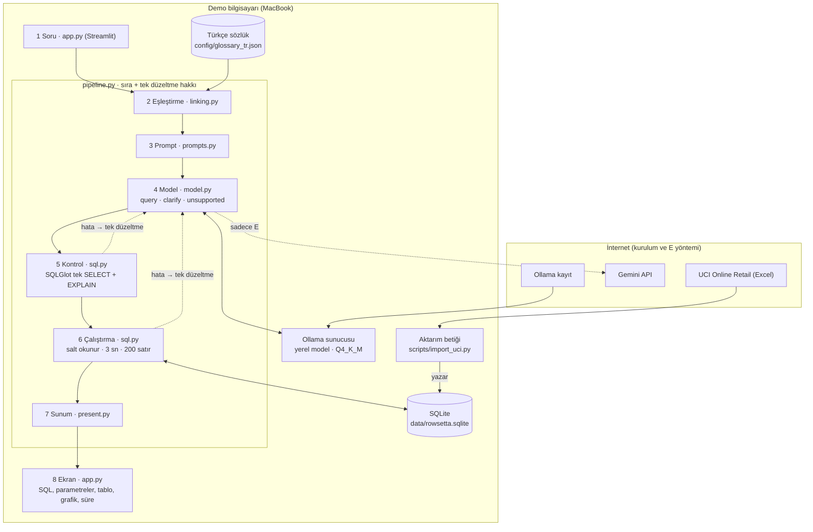
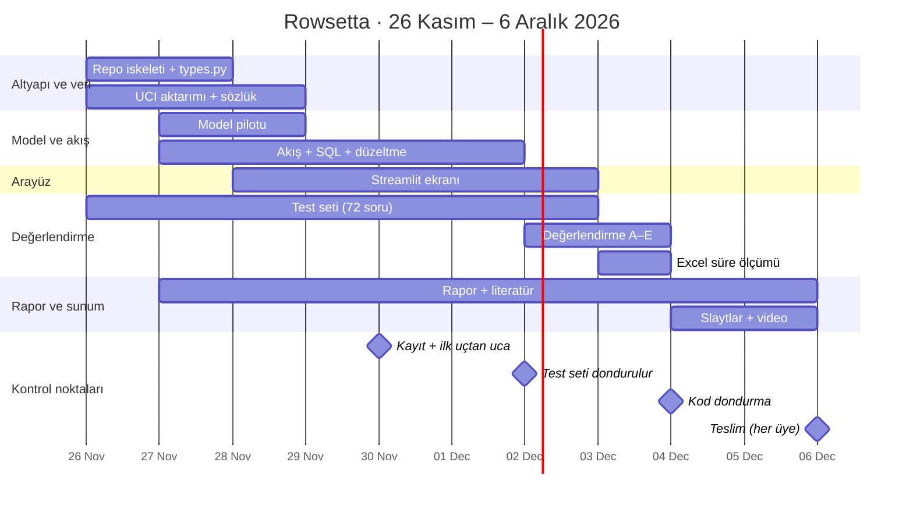

# Rowsetta – Mimari ve Yol Haritası

26 Kasım 2026 · SixthSense · SWE015 Topic 6 (Text-to-SQL)

Rowsetta, Türkçe sorulan satış sorularını doğrulanmış SQL'e çevirip sonucu tablo ve grafikle gösteren, tamamen demo bilgisayarında çalışan bir uygulama. Teslim: 6 Aralık 2026, 23.59.

Bu dosya ekibin ortak dokümanının repo kopyasıdır. Görev dağılımı eklenince güncellenecek.

## Kapsam

Hedef: SQL bilmeyen bir satış analisti, Türkçe soruyu yazıp doğru cevabı Excel'den daha kısa sürede, hangi sorgunun çalıştığını da görerek alsın.

- **Kullanıcı:** Türkçe konuşan perakende satış analisti.
- **Veri:** UCI Online Retail (Aralık 2010 – Aralık 2011, GBP, İngiltere merkezli çevrimiçi satıcı).
- **Ders konusu:** T6 – Text-to-SQL. Uygulama soruyu, üretilen SQL'i, sonuç tablosunu ve grafiği göstermek zorunda.
- **Başarı ölçütü:** 60 soruluk test setinde execution accuracy, canlı demoda iki farklı yeni soru (biri zor) ve soru başına kazanılan süre.

### 100 için şart olanlar

1. Streamlit'te soru → SQL → tablo → grafik akışı
2. Türkçe sözlükle alan ve değer eşleştirme (schema linking)
3. SQLGlot ile "tek SELECT" kontrolü ve salt okunur SQLite bağlantısı
4. Hata olursa modele tek düzeltme hakkı (otomatik hata düzeltme)
5. Execution accuracy ölçümü
6. En az 3 alternatifin ölçülmesi (yerel ve ticari model karşılaştırması dahil)
7. Excel ile süre karşılaştırması (kazanç ve değer)

### Vakit kalırsa

- SQLite authorizer ile fonksiyon kısıtlaması (`mode=ro` ve `query_only` şimdilik yeterli)
- SQLGlot ile sütun ve CTE çözümlemesi (bilinmeyen sütunu SQLite zaten yakalıyor)
- Açıklama sorusunda önceki kısıtları taşıyan çok turlu akış
- İkinci, sınırları değiştirilmiş veri örneğinde tekrar test
- Atomik ve sürümlü veri dosyası değişimi

Kapsam dışı: stok, alış maliyeti, kâr marjı ve müşteri bazlı sorular. Uygulama bunlarda hangi verinin eksik olduğunu söyler.

## Mimari

Model sadece SQL yazar; tüm sayıları salt okunur SQLite hesaplar. Demo sırasında internet gerekmez; sadece kurulum ve E yöntemi (Gemini) dışarı çıkar.



## Bileşenler ve arayüzler

Her modülün tek bir sahibi var ve modüller birbirine sadece `rowsetta/types.py` içindeki veri sınıflarıyla bağlanıyor. Bu sınıflar ilk gün yazılır, herkes diğerlerinin sahte (stub) sürümüyle paralel çalışır.

| # | Bileşen | Dosya | Girdi → çıktı | Bağımlı olduğu |
| --- | --- | --- | --- | --- |
| 1 | Veri aktarımı | `scripts/import_uci.py`, `db/schema.sql` | `Online Retail.xlsx` → `data/rowsetta.sqlite` + `data/import_report.json` | — |
| 2 | Sözlük ve eşleştirme | `rowsetta/linking.py`, `config/glossary_tr.json` | Türkçe soru → `LinkedQuestion` | Şema |
| 3 | Prompt oluşturma | `rowsetta/prompts.py` | `LinkedQuestion` + şema özeti + örnekler → model mesajları | 2 |
| 4 | Model istemcisi | `rowsetta/model.py` | mesajlar → `ModelResponse` + `ModelCall`; `OllamaBackend`, `GeminiBackend` | Ollama, Gemini API |
| 5 | SQL doğrulama ve çalıştırma | `rowsetta/sql.py` | `sql` + `params` → `QueryResult` ya da `SqlError` | 1 |
| 6 | Akış denetleyicisi | `rowsetta/pipeline.py` | soru → `Answer` | 2–5 |
| 7 | Sonuç sunumu | `rowsetta/present.py` | `QueryResult` → GBP biçimli tablo + grafik türü | — |
| 8 | Arayüz | `app.py` | kullanıcı sorusu → `Answer` ekranı | 6, 7 |
| 9 | Değerlendirme | `eval/questions.jsonl`, `eval/run.py`, `eval/templates.py` | test seti × yöntem → `eval/results/*.csv` | 5, 6 |

Sözleşmelerin kendisi: [`rowsetta/types.py`](../rowsetta/types.py). Ortam ayarları: [`rowsetta/settings.py`](../rowsetta/settings.py).

## Veri katmanı

GPT paketindeki iki tablolu şema korunuyor; tek ekleme ürün olmayan kodları ayıran `is_product` alanı ([`db/schema.sql`](../db/schema.sql)). Para tam sayı birimde tutulur (1 GBP = 10.000 birim), tarih aralıkları başlangıç dahil, bitiş hariçtir.

### Aktarım kuralları

1. Excel `pandas.read_excel` ile okunur. Fiyat `Decimal(str(x))` ile çevrilir; `Decimal(x)` kullanılırsa 2.55 gibi fiyatlar 2.5499… olur ve yanlışlıkla elenir.
2. Fatura numarası C ile başlıyorsa ya da miktar negatifse `net_qty = -abs(miktar)`.
3. A ile başlayan faturalar ("Adjust bad debt") tamamen dışlanır; pozitif fiyatlı olanı da satış sayılmamalı.
4. Sıfır miktar, pozitif olmayan fiyat ve boş zorunlu alan elenir; her eleme nedeni sayılıp `import_report.json`'a yazılır.
5. Standart desene (5 rakam + isteğe bağlı harf) uymayan stok kodları listelenir, sahibi bunları elle sınıflandırır ve `is_product = 0` olanlar `config/non_product_codes.json`'a yazılır.
6. Ürün adı, kabul edilen satırlardaki en son dolu açıklamadır.
7. Müşteri kimliği aktarılmaz.
8. Rapor: ham, kabul edilen ve elenen satır sayısı, kaynak dosya özeti (SHA-256), kural sürümü.

### Türkçe sözlükte olması gerekenler

- **Ülkeler:** İngilizce kayıtlı. "Fransa → France", "İrlanda → EIRE", "Güney Afrika → RSA", "İngiltere / Birleşik Krallık → United Kingdom". Tam liste aktarımdan sonra `SELECT DISTINCT country` ile çıkarılır.
- **Ölçüler:** "ciro, satış tutarı, hasılat → net_sales", "kaç adet, satılan adet → sold_qty", "kaç fatura, sipariş sayısı → invoice_count", "iade, iptal → credit".
- **Tarihler:** Türkçe ay adları ve ekleri ("Mayıs'ta", "mart ayında"), "ilk çeyrek", "son 3 ay". Yıl verilmezse veri aralığına bakılır: Aralık dışındaki aylar sadece 2011'de var, sadece Aralık için yıl sorulur.
- **Ürünler:** Ürün adları İngilizce. Ürünle ilgili test soruları ürün koduyla ya da İngilizce adıyla sorulur.

### Bilinen veri tuzakları (test sorusu olarak da kullanılır)

- Aynı gün iptal edilen çok büyük siparişler var (±80.995 adet): brüt satışı şişirir, net satışı etkilemez.
- POST, DOT, M gibi kodlar ürün sıralamasında üst sıralara çıkabilir; `is_product = 1` filtresi bunu önler.
- Aynı faturada tekrar eden satırlar ayrı satır olarak kalır (bilinçli karar, raporda belirtilir).

## Sorgu akışı

Model sadece SQL taslağı yazar; her sayıyı SQLite hesaplar ve ekranda yalnızca gerçekten çalışan sorgu gösterilir.

1. **Eşleştirme:** `linking.py`, sözlükle ölçüyü, ülkeleri ve dönemi bulur. Ölçü belirsizse ("en çok satan" = adet mi tutar mı?) modele gitmeden açıklama sorusu döner.
2. **Prompt:** Şema özeti, ölçü tanımları, eşleşen değerler ve geliştirme setinden 3–5 örnek. Test soruları asla örnek olarak konmaz.
3. **Model:** Ollama structured output (ya da Gemini JSON modu), sıcaklık 0. Yanıt `MODEL_RESPONSE_SCHEMA`'ya uymak zorunda.
4. **Doğrulama:** SQLGlot (`dialect="sqlite"`) ile tek ifade, sadece `SELECT` ya da `WITH … SELECT`, tablolar sadece `sales` ve `products`. Ardından SQLite `EXPLAIN` ile hazırlanır; bilinmeyen sütun burada yakalanır. Parametre adları SQL'dekilerle eşleşmeli.
5. **Çalıştırma:** `file:...?mode=ro` + `PRAGMA query_only=ON`, 3 saniye süre sınırı (progress handler), en fazla 201 satır çekilir (200 gösterilir, 201. satır "kesildi" işareti).
6. **Tek düzeltme hakkı:** 4. ya da 5. adımda söz dizimi, sütun veya parametre hatası olursa hata mesajı ve ilk SQL modele geri verilir. İkinci hata `error` ile biter. Güvenlik reddi ve süre aşımı düzeltmeye gitmez.
7. **Sunum:** `present.py` tutarları GBP'ye çevirip iki ondalığa yuvarlar, grafik türünü sütunlardan seçer.

```json
{
  "kind": "query",
  "sql": "SELECT country, SUM(net_u) AS net_sales_u FROM sales WHERE invoice_at >= :start AND invoice_at < :end AND country IN (:c1, :c2) GROUP BY country ORDER BY net_sales_u DESC",
  "params": {"start": "2011-05-01 00:00:00", "end": "2011-06-01 00:00:00", "c1": "France", "c2": "Germany"},
  "metric": "net_sales",
  "message": null
}
```

| Durum | Ne zaman | Ekranda |
| --- | --- | --- |
| `ok` | Sorgu çalıştı, satır var | Soru, SQL, parametreler, tablo, grafik, süre |
| `empty` | Sorgu çalıştı, satır yok | SQL, sütun başlıklarıyla boş tablo, "Bu filtrelerle kayıt bulunamadı" |
| `clarify` | Ölçü ya da dönem belirsiz | Tek Türkçe soru + seçenek düğmeleri |
| `unsupported` | Veride olmayan bilgi (maliyet, kâr, stok) | Eksik bilginin adı |
| `error` | İkinci hata, süre aşımı, model kapalı | Kısa hata açıklaması + denenen SQL |

Grafik kuralı: kategoriye göre sıralama → çubuk, zamana göre → çizgi, tek sayı → değer kartı. Grafik Streamlit'in yerleşik Altair desteğiyle çizilir.

## Değerlendirme

Ana metrik execution accuracy: 60 yanıtlanabilir sorudan kaçı referans SQL ile aynı sonucu veriyor. Hatalar ve çözülemeyen sorular paydada kalır. Tüm sayılar bizim çalıştırmalarımızdan gelir. Dosya biçimi: [`eval/README.md`](../eval/README.md).

### Test seti

- **60 yanıtlanabilir soru:** 20 filtre/gruplama, 20 sıralama veya iki tablolu, 20 zaman/iptal senaryosu. Hepsi tek anlamlı yazılır.
- **6 belirsiz soru:** doğru davranış `clarify`.
- **6 kapsam dışı soru:** doğru davranış `unsupported`.
- **Ayrı geliştirme seti:** 20 soru. Prompt ve sözlük sadece bununla ayarlanır; test seti 2 Aralık'ta dondurulur.
- Her sorunun referans SQL'ini bir kişi yazar, başka biri sonucu kontrol eder.

### Karşılaştırılan yöntemler (R5)

| Yöntem | Ne yapıyor | Neyi gösteriyor |
| --- | --- | --- |
| A · Şablon | 8–10 hazır SQL şablonu + anahtar kelime eşleştirme, LLM yok | Kural tabanlı yaklaşımın kapsam sınırı |
| B · Doğrudan LLM | Soru + şema, tek çağrı | Sözlüksüz taban çizgi |
| C · LLM + sözlük | B + Türkçe eşleştirme ve ölçü tanımları | Schema linking'in katkısı |
| D · Rowsetta (yerel) | C + tek düzeltme hakkı, yerel model | Seçilen sistem |
| E · Rowsetta (API) | D ile aynı akış, ticari model (Gemini Flash) | Yerel ve ticari model farkı: doğruluk, hız, maliyet, gizlilik |

A–D aynı çalıştırıcıyı ve SQL kontrolünü kullanır. B–D aynı yerel modeli ve ayarları kullanır. Gemini'nin ücretsiz katmanında gönderilen veri ürün geliştirmede kullanılabildiği için bu, gizlilik sütununa yazılır.

### Kaydedilecek ölçümler

- **Doğruluk:** ilk deneme ve düzeltme sonrası execution accuracy; sıralı sorularda sıra da kontrol edilir. Tutarlar yuvarlanmadan önce karşılaştırılır.
- **Davranış:** 6 belirsiz soruda doğru `clarify` oranı, 6 kapsam dışı soruda doğru `unsupported` oranı.
- **Düzeltme:** düzeltmeye giden sorgu sayısı ve bunların kaçının düzeldiği.
- **Hız:** medyan ve p95 uçtan uca süre (model ısınmışken), ilk açılış süresi, soru başına model çağrısı.
- **Maliyet:** API için gerçek token sayısı × liste fiyatı; yerel model için ek maliyet sıfır, donanım ve süre ayrıca yazılır.
- **Kazanç (R7):** 4–6 kişi, 5 görevi Excel'de ve Rowsetta'da çözer; yarısı Excel'le, yarısı Rowsetta'yla başlar. Doğru tamamlanan görev başına süre farkı raporlanır.
- **Hata örneği:** raporun 7. başlığı için en az bir yanlış cevap ve nedeni saklanır.

### 1. gün model denemesi

27 Kasım'da 10 geliştirme sorusuyla üç aday denenir: `qwen2.5-coder:7b` (GPT'nin seçimi), Qwen3 8B sınıfı daha yeni bir genel model ve Gemini Flash. Demo bilgisayarında en iyi doğruluk/süre dengesini veren yerel model D'nin modeli olur.

## Repo yapısı ve çalışma düzeni

```
SixthSense/
├── README.md                  # kurulum + tek çalıştırma komutu
├── requirements.txt
├── .env.example               # GEMINI_API_KEY=, OLLAMA_MODEL=
├── .gitignore                 # .env, data/, *.xlsx, *.sqlite, eval/results/
├── app.py                     # Streamlit
├── rowsetta/
│   ├── types.py               # ortak veri sınıfları (ilk gün)
│   ├── settings.py            # ortam ayarları
│   ├── linking.py
│   ├── prompts.py
│   ├── model.py
│   ├── sql.py
│   ├── pipeline.py
│   └── present.py
├── config/
│   ├── glossary_tr.json
│   └── non_product_codes.json
├── db/schema.sql
├── scripts/
│   ├── setup.sh               # bağımlılık + veri indir + aktar + ollama pull
│   └── import_uci.py
├── eval/
│   ├── README.md
│   ├── dev_questions.jsonl
│   ├── questions.jsonl
│   ├── templates.py           # yöntem A
│   └── run.py
├── tests/                     # GPT paketindeki doğrulama, pytest'e çevrildi
└── docs/
    ├── architecture.md
    ├── ai-usage.md
    └── archive/gpt-architecture-draft.md
```

**Tek çalıştırma komutu (R8):** `./scripts/setup.sh && streamlit run app.py`. Excel dosyası (22,6 MB) ve model ağırlıkları repoya konmaz; `setup.sh` indirir.

### Çalışma kuralları

- Herkes kendi modülü için `feature/<modül>` branch'i açar; `main`'e küçük PR'larla, en az bir kişinin onayıyla girer.
- `types.py` 27 Kasım akşamı dondurulur. Değişiklik gerekirse grupta haber verilir.
- Her modülün en az bir testi olur ve 12 satırlık sentetik veriyle (`tests/fixtures/`) çalışır; gerçek veri gelmeden kimse beklemez. Testler: `python -m pytest -q`.
- API anahtarı sadece `.env`'de. Repoya anahtar girerse anahtar hemen iptal edilir.
- Yapay zekâ ile üretilen her parça PR açıklamasına "AI: araç, ne için, nasıl kontrol edildi" satırıyla yazılır ve [`docs/ai-usage.md`](ai-usage.md)'ye eklenir (R10).

## Yol haritası

Tüm işler bugün paralel başlıyor; her kontrol noktası bir öncekinin şartları tamamlanmadan geçilmez.



1. **30 Kasım – Kayıt + ilk uçtan uca:** Excel kaydı "Complete"; gerçek veride bir Türkçe soru Streamlit'te SQL, tablo ve grafiğe ulaşıyor.
2. **2 Aralık – Test seti dondurulur:** 72 soru ve referans SQL'leri iki kişi tarafından kontrol edildi; prompt ve sözlük artık sadece geliştirme setine göre değişir.
3. **4 Aralık – Kod dondurma:** temiz bir bilgisayarda README'deki tek komutla kurulum çalışıyor; mimari çizimi koddan yeniden çizildi; tüm sonuç tabloları `eval/results/` dosyalarından.
4. **6 Aralık 23.59 – Teslim:** rapor PDF, sunum PDF, video linki ve repo linki her üyenin kendi hesabından yüklendi.

## Teslim kontrol listesi

- [ ] **Kayıt:** Excel'de takım, T6 konusu ve her üyenin teknik bileşeni girildi, Status "Complete" (30 Kasım 23.59)
- [ ] **R1 Uygulama:** Streamlit, yazılan yeni soruya cevap veriyor
- [ ] **R2 Canlı demo:** videoda ve sunumda iki farklı yeni soru, biri zor
- [ ] **R3 Mimari çizimi:** çalışan koddan yeniden çizildi; model adı, sağlayıcı, nicemleme ve her parçanın nerede çalıştığı üzerinde
- [ ] **R4 Literatür:** en az 5 kaynak (hedef 7), her biri açılıp doğrulandı
- [ ] **R5 Alternatifler:** A–E karşılaştırma tablosu, model seçimi gerekçesi dahil
- [ ] **R6 Sonuçlar:** test seti dondurulmuş, tüm sayılar `eval/results/` dosyalarından
- [ ] **R7 Kazanç:** Excel karşılaştırması, hesap yöntemiyle
- [ ] **R8 Repo:** README, tek komut, `requirements.txt`, anahtar ve ağırlık yok; temiz bir bilgisayarda denendi
- [ ] **R9 Rol tablosu:** raporda ve Excel'le aynı
- [ ] **R10 AI kullanımı:** raporda tablo + sunumda tek slayt
- [ ] **Rapor:** 9 başlık sırasıyla, en az bir hata örneği
- [ ] **Video:** en fazla 2 dakika, gizli pencerede link açılıyor
- [ ] **Teslim:** her üye kendi hesabından yükledi (6 Aralık 23.59)

## Görev dağılımı

Ekip listesi gelince doldurulacak. Her üye en az bir teknik bileşenin sahibi olmalı (bileşen tablosundaki 1–9).

## Kaynaklar

Raporda kullanılmadan önce her kaynağı ekipten biri açıp doğrulamalı (uydurma kaynak = 0).

**Literatür (R4, hedef 7)**

- Wang vd., [RAT-SQL](https://aclanthology.org/2020.acl-main.677/), ACL 2020 — schema linking.
- Pourreza ve Rafiei, [DIN-SQL](https://papers.neurips.cc/paper_files/paper/2023/hash/72223cc66f63ca1aa59edaec1b3670e6-Abstract-Conference.html), NeurIPS 2023 — ayrı düzeltme aşaması.
- Zhong, Yu ve Klein, [Distilled Test Suites](https://aclanthology.org/2020.emnlp-main.29/), EMNLP 2020 — sonuç üzerinden anlam kontrolü.
- Li vd., [BIRD](https://arxiv.org/abs/2305.03111), NeurIPS 2023 — gerçek değerler ve veri içeriğiyle test.
- Aktaş vd., [BIRDTurk](https://aclanthology.org/2026.sigturk-1.13/), SIGTURK 2026 — Türkçede performans düşüşü.
- Kanburoğlu ve Tek, [TURSpider](https://research.itu.edu.tr/en/publications/turspider-a-turkish-text-to-sql-dataset-and-llm-based-study/), IEEE Access 2024 — Spider'ın Türkçe insan çevirisi.
- Kanburoğlu ve Tek, [TUR2SQL](https://github.com/alibugra/TUR2SQL), UBMK 2023 — ilk açık Türkçe Text-to-SQL veri seti.

**Veri ve araçlar**

- [UCI Online Retail](https://archive.ics.uci.edu/dataset/352/online+retail) — Chen, D., DOI 10.24432/C5BW33
- [Ollama model etiketi](https://ollama.com/library/qwen2.5-coder:7b-instruct-q4_K_M) · [Ollama structured outputs](https://docs.ollama.com/capabilities/structured-outputs)
- [Gemini API fiyatlandırma ve ücretsiz katman](https://ai.google.dev/gemini-api/docs/pricing)
- [SQLGlot](https://sqlglot.com/sqlglot.html) · [Python sqlite3](https://docs.python.org/3/library/sqlite3.html) · [SQLite generated columns](https://sqlite.org/gencol.html)
- [Streamlit](https://docs.streamlit.io/get-started/fundamentals/main-concepts)
