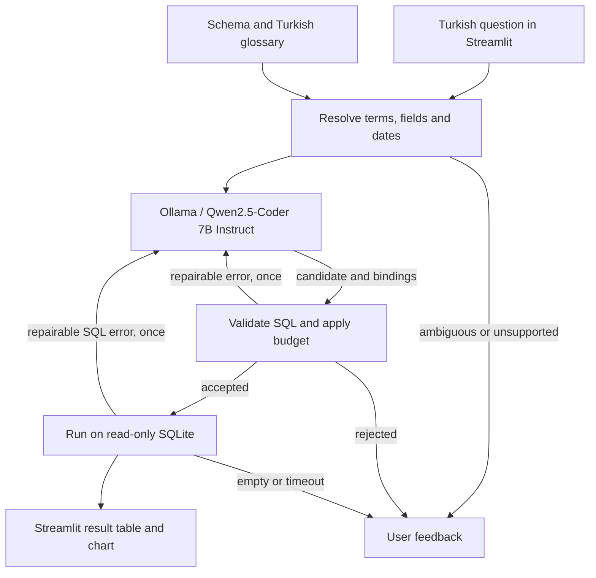

# Rowsetta - From Turkish Questions to SQL

SixthSense · SWE015 Topic 6 · Architecture proposal · 26 November 2026

## Scope and baseline

Rowsetta will help a Turkish-speaking retail analyst answer questions about invoice activity. The user will see the original question, the executed SQL and bound values, the result table and a visualization. The recorded project title and Topic 6 are team choices. Retail, UCI Online Retail and the local model below are design choices for this first implementation.

The inspected [main commit](https://github.com/DorukArtan/SixthSense/tree/6fb32a2d3b9b3dcf62bcf3c80f882085c7ac6c1a) contained one file, a README with the team name. This design package supplies a SQLite schema and a runnable reference check. The full importer, Streamlit UI, LLM pipeline and project evaluation are planned.

## System boundary

One Streamlit process coordinates one local Ollama process and one versioned, read-only SQLite snapshot. The setup step fetches the public workbook and the model. A question at demo time requires only the local machine. The model receives selected schema metadata, approved field definitions and example values. It drafts SQL. The database engine computes all numbers.



The once-only correction budget is shared across validation and execution. The controller also accepts a clarification or unsupported response from the model before attempting validation. An empty valid result retains the executed SQL and table headers in the UI. Security rejections, timeouts and a failed model service end that attempt. A clarification answer starts a new attempt with the user's previous constraints.

### Execution components

| Component | Implementation target | Contract |
| --- | --- | --- |
| UI | `app.py` · Streamlit on demo host | Collect a Turkish question and clarifications. Render the exact executed query, bindings, units, period, table and visualization. |
| Controller and term mapping | `rowsetta/pipeline.py`, `config/retail.json` | Map Turkish synonyms and country aliases to the approved fields and values. Interpret dates on the dataset timeline. Track status, original constraints and one repair budget. |
| Model client | `rowsetta/model.py` · Ollama on loopback | Call the open-weight Qwen2.5-Coder-7B-Instruct model, Q4_K_M; use typed JSON output and temperature 0. Record exact model digest, prompt version and context settings for evaluation. |
| Validation and querying | `rowsetta/sql.py` · Python process | Parse a single SQLite SELECT or SELECT-producing WITH query using SQLGlot. Resolve referenced columns, aliases and CTEs. Validate value bindings. Compile and execute on the read-only snapshot under a deadline. |
| Results | `rowsetta/present.py` · Python process | Render money using Decimal, choose chart from actual column types and group semantics, and preserve column names and empty results. |
| Data setup | `scripts/import_uci.py`, `db/schema.sql` | Build a fresh snapshot in a temporary file. Check counts, constraints and metadata before replacing the versioned snapshot. A failed import preserves the last good snapshot. |
| Evaluation | `eval/questions.jsonl`, `eval/run.py` | Run frozen prompts and reference SQL against the same snapshot. Record outcomes, model calls, latency and configuration by question ID. |

The package supplies the schema, this design document, the reference query, the fixture and its verification script. The other target paths above define future implementation boundaries.

## Data model and metric definitions

Use the public [UCI Online Retail workbook](https://archive.ics.uci.edu/dataset/352/online+retail) under CC BY 4.0, attributed to Daqing Chen, DOI 10.24432/C5BW33. It describes historical UK retail invoice lines denominated in GBP. The app exposes invoices, products, dates and countries. Stock levels, acquisition costs and profit require other data. The snapshot omits customer identifiers.

| SQLite relation | Grain | Fields |
| --- | --- | --- |
| `products` | One row per stock code | `stock_code` (PK), `product_name` (nullable). Use the latest nonempty description among accepted lines, breaking a timestamp tie by source row. |
| `sales` | One accepted source line | `line_id` (PK), `invoice_no`, `invoice_at`, `country`, `stock_code` (FK), `net_qty`, `unit_price_u`, and the derived columns `sold_qty`, `gross_u`, `credit_u`, `net_u`. |

1. Preserve the source line number and invoice identifier as separate fields. Dates use an ISO local timestamp as supplied. Use half-open intervals, including the lower bound and excluding the upper bound.
2. Parse source prices as decimal values. One GBP equals 10,000 integer units. Quarantine a non-integral scaled price, a nonpositive price, zero quantity, or an invalid required field; retain reason counts. Check per-line and aggregate integer range on the full import. Record raw, accepted and rejected counts, import rule version and source checksum. Keep legitimate repeated lines separate.
3. If the invoice starts with C (case-insensitive) or quantity is negative, set `net_qty = -abs(quantity)`. Otherwise use the positive quantity. The C prefix is documented by UCI; treating other negative rows as credits/adjustments is our explicit rule. The credit is dated to its own invoice.
4. `sold_qty = max(net_qty,0)`; `gross_u = sold_qty × unit_price_u`; `credit_u = max(-net_qty,0) × unit_price_u`; `net_u = gross_u - credit_u`. Sum integer units first and round half up to two GBP decimals for display. “Net sales” refers to the included invoice-line amount. With these rules, qualifying service or carriage lines also contribute.
5. Use the many-to-one join `sales.stock_code = products.stock_code` for a product label. A missing description still has a product key. Display the code when the label is absent. Count invoices with `COUNT(DISTINCT invoice_no)` after explicitly choosing ordinary or credit invoices, as appropriate to the user's question.

## Request and result behaviour

“Mayıs 2011’de Fransa ve Almanya’nın net satış tutarlarını karşılaştır.” resolves to the stored country values France and Germany, half-open May dates and SUM of net units grouped by country. The checked reference SQL is in `examples/country_net.sql`.

The model response uses a tagged union. With `kind=query` it must include `sql`, `params` and the selected metric key; `kind=clarify` and `kind=unsupported` each carry one short Turkish message instead. Validate the variant and all required fields before using it. The app returns a separate `ok`, `empty`, `clarify`, `unsupported` or `error` status to the interface.

- For “Mayıs 2011’de en çok satan beş ürün hangisi?”, ask “Satılan adede göre mi, net satış tutarına göre mi sıralayayım?” Preserve month and top-five constraints. Bind user values separately from SQL identifiers.
- For “Kâr marjı en yüksek ürün hangisi?”, explain which cost field would be needed. The evaluator scores this as `unsupported`.
- For an `ok` response, include executed SQL, bindings, columns, rows, chart type, units, truncation flag and elapsed time. A categorical ranking uses bars, a time series uses a line and a single scalar uses a value card alongside the one-row table. Use a grouped question for the required chart demo. Show a zero count as zero, a SUM with no matching input as “veri yok”, and an empty grouped result as an empty table with its column headers.
- Open the database with URI `mode=ro`. In the application connection, enable `query_only`, restrict read operations to the approved schema and functions via the SQLite authorizer, and interrupt long-running queries via the progress handler. Start with a 3-second SQL deadline, a configurable model-call deadline and a 200-row UI preview (fetch one extra row to detect truncation). These budgets are design settings for the demo pilot. Apply the preview cap after grouping and ordering.
- Open SQLite via a file URI with `mode=ro`, enable `query_only`, allow only the two public relations and approved functions with the SQLite authorizer, and keep extension loading disabled. Enforce a monotonic deadline using a progress handler. Begin with a 3-second DB budget and at most 200 display rows, fetching a 201st result to mark a preview. Apply the display bound to the final result; totals must cover the full requested period. Validate parameter names/counts and validate all retry candidates under the same policy.
- Log request ID, dataset checksum, prompt/model versions, outcome, repair count and per-stage durations. Avoid storing raw user questions by default; the evaluation runner uses identified, public test questions. If the model is unavailable, show a service error.

## Verification delivered with this design

Unpack at the repository root or in a separate folder. Run the following from the unpacked root with Python 3.11+ and SQLite 3.31+.

```console
python examples/verify_design.py
```

The script creates a temporary SQLite file and a read-only connection, then removes its temporary data on exit. It requires no additional Python packages. The package contains this document, `db/schema.sql`, `examples/retail_fixture.csv`, `examples/country_net.sql` and `examples/verify_design.py`.

The 12 synthetic rows yield 10 accepted rows and 2 explained exclusions. The checks exercise signed quantities, date boundaries, joined row count, product label selection, final rounding, empty results and blocking a write on the read-only connection. The reference query yields **France GBP 32.50** and **Germany GBP 18.13**. These are fixture results for hand-written SQL. Model quality, latency, cost, the UI and the complete UCI workbook require a separate run.

## Evaluation and delivery

Compare four configurations on one frozen test set: fixed templates, direct LLM with schema, LLM with glossary/schema linking only, and the proposed pipeline with one repair. Use identical model, database, per-call settings and guard for the LLM variants; only the proposed pipeline gets the extra repair call. The template baseline shares the query executor. Reserve 60 answerable questions (20 filter/group, 20 ranking or multi-table, 20 temporal/credit cases) and 12 additional questions (6 clarification, 6 missing-data). Use separate development examples; keep close paraphrases together in the same split. Have two reviewers independently write/check the gold question semantics, SQL and canonical result. Define ordering, tie handling, units and tolerances before running.

Execution accuracy is the number of answerable questions returning the reference result divided by all answerable questions, counting errors and unresolved clarifications as failures. For an ordered question, verify rank order; for an unordered one, compare row multisets with duplicate counts. Compare integer currency amounts before display rounding. Add boundary-perturbed fixtures where multiple queries happen to give the same result. Report first-pass and final accuracy, correct clarification/unsupported rates separately, median and p95 end-to-end latency for warm runs, cold-start delay, and repair success on the subset of retried queries. Repeat the selected tasks manually in a spreadsheet and in the app in counterbalanced order to estimate seconds saved per correctly completed task. Record sample size, device, local model settings and actual costs.

| Suggested milestone | Evidence needed |
| --- | --- |
| 26–28 Nov | Generate the UCI snapshot and run a handful of real Turkish questions on the demo hardware. Document input counts, model availability and observed errors. |
| 29–30 Nov | Complete one vertical slice in Streamlit. Test a new question and clarification. Team registration due 30 Nov at 23:59. |
| 1–3 Dec | Freeze the evaluation set and configurations; run the comparison, safety checks and value measurement. |
| 4–6 Dec | Check installation on a clean machine. Complete report, slides, two-minute video and repository. Each student submits by 6 Dec at 23:59. |

The course report will require members' own role allocation and a verified AI usage statement. Cite model assistance in this architecture draft and record who reviews and tests the final implementation. The report, metrics and diagram for submission must describe the code that actually runs.

## Research and implementation references

- Wang et al., [RAT-SQL](https://aclanthology.org/2020.acl-main.677/), ACL 2020. Supports the schema-linking design.
- Pourreza and Rafiei, [DIN-SQL](https://papers.neurips.cc/paper_files/paper/2023/hash/72223cc66f63ca1aa59edaec1b3670e6-Abstract-Conference.html), NeurIPS 2023. Motivates a separate correction stage.
- Zhong, Yu and Klein, [Semantic Evaluation for Text-to-SQL with Distilled Test Suites](https://aclanthology.org/2020.emnlp-main.29/), EMNLP 2020. Supports checking result semantics on more than one data configuration.
- Li et al., [BIRD](https://arxiv.org/abs/2305.03111), NeurIPS 2023. Motivates testing values, database contents and query efficiency.
- Aktaş et al., [BIRDTurk](https://aclanthology.org/2026.sigturk-1.13/), SIGTURK 2026. Motivates tests with Turkish user wording and schema terminology.
- Official implementation references: [model tag](https://ollama.com/library/qwen2.5-coder:7b-instruct-q4_K_M), [Ollama structured output](https://docs.ollama.com/capabilities/structured-outputs), [Python sqlite3](https://docs.python.org/3/library/sqlite3.html), [SQLite generated columns](https://sqlite.org/gencol.html), [SQLGlot](https://sqlglot.com/sqlglot.html), [Streamlit](https://docs.streamlit.io/get-started/fundamentals/main-concepts).
